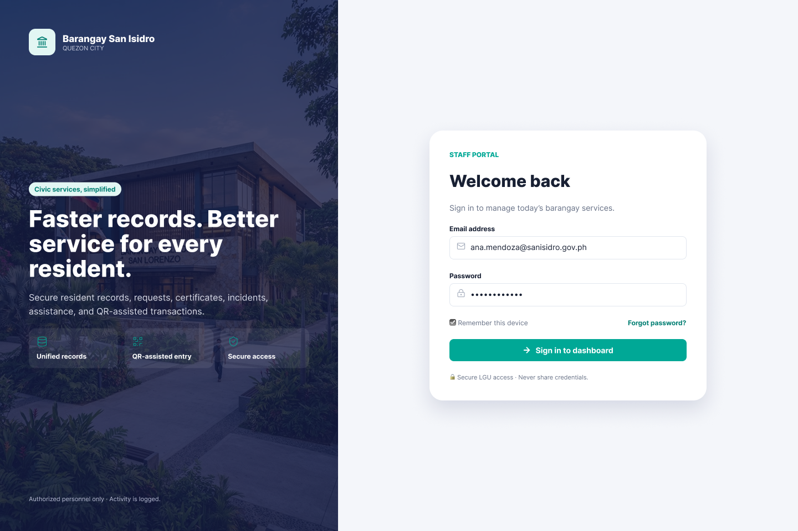
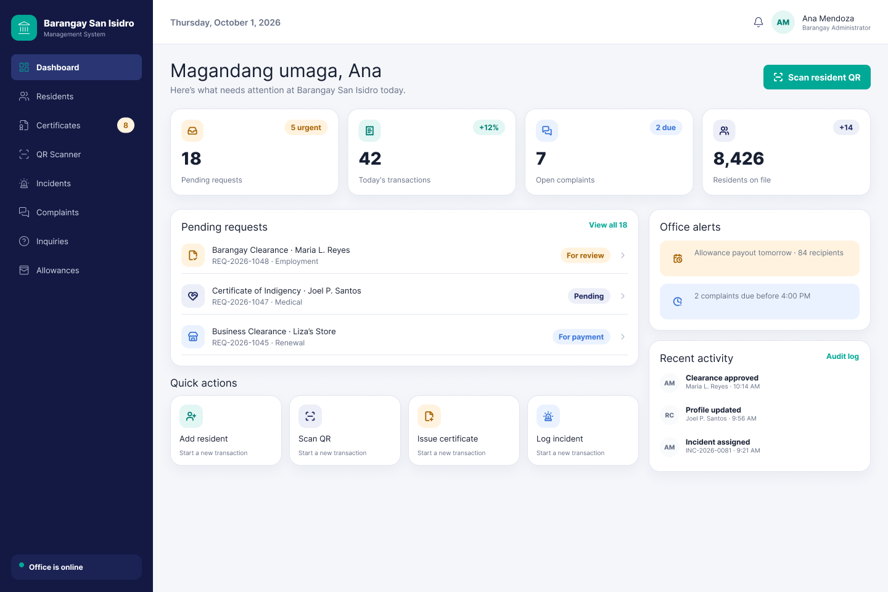
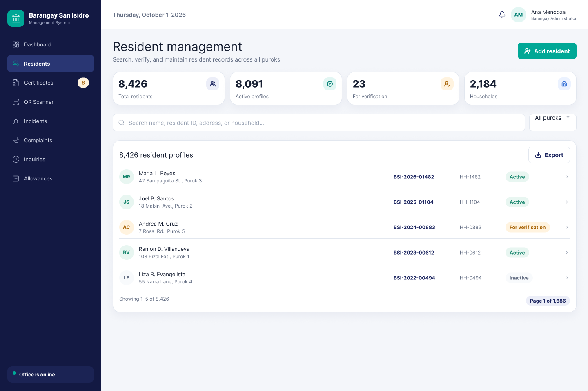
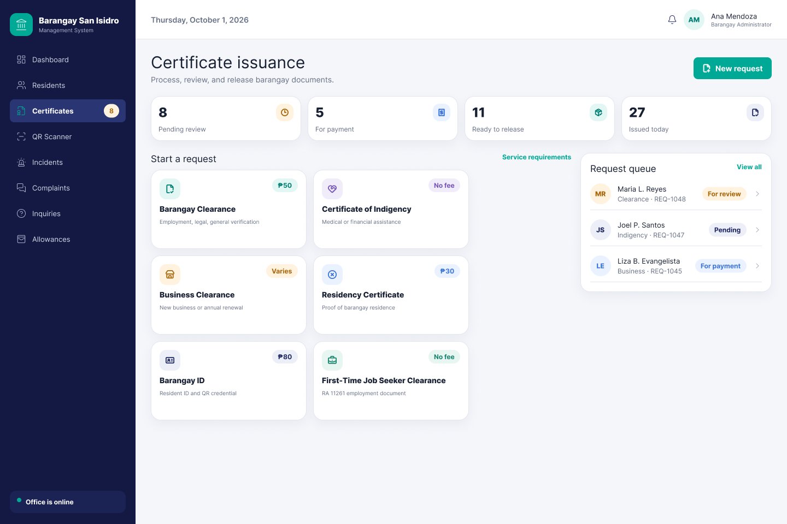
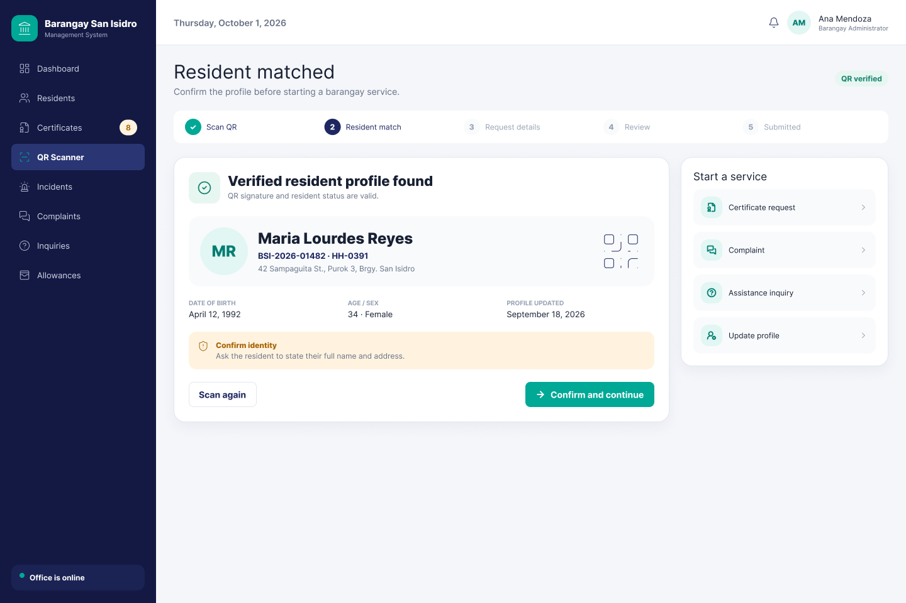
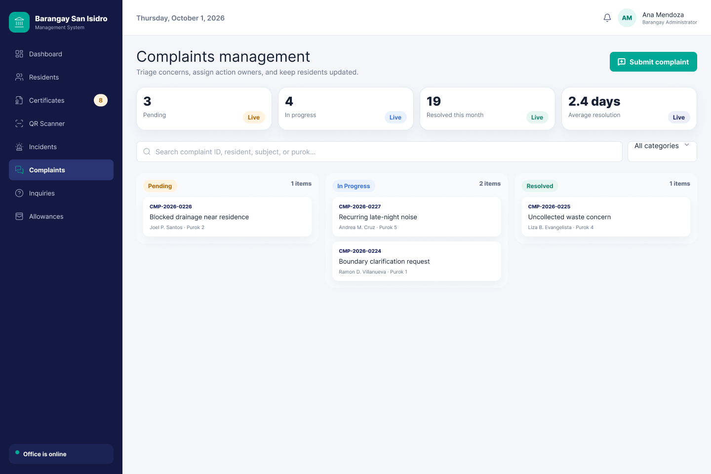
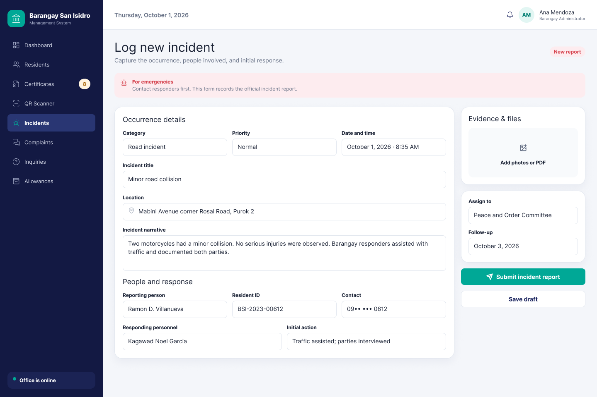
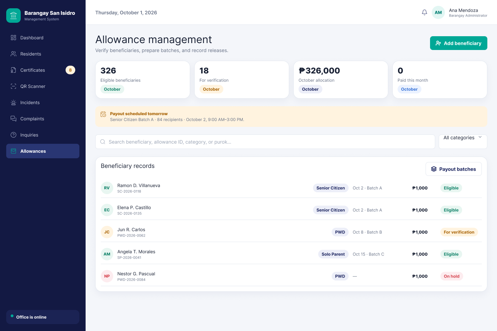

# Barangay San Isidro Management System

A front-end web application for barangay staff to manage resident records, certificate requests, QR-assisted transactions, incidents, complaints, assistance inquiries, and allowances in one place.

## Concept

Barangay offices still rely on paper forms, separate logbooks, and manual searching for resident records. A single request can mean re-writing the same details several times. This project proposes a unified staff portal where a resident's record is entered once and reused across every service.

## Purpose

- Replace paper-based processing with one searchable resident database.
- Speed up certificate issuance with auto-filled requests and QR-assisted resident lookup.
- Keep incidents, complaints, and assistance requests traceable from filing to resolution.

## Features

| Module                 | What it does                                                |
| ---------------------- | ----------------------------------------------------------- |
| Login                  | Staff sign-in screen for the portal                         |
| Dashboard              | Pending requests, alerts, daily counts, and quick actions   |
| Residents              | Search by name, ID, address, or household; filter by purok  |
| Certificates           | Choose a resident and certificate type, preview, then issue |
| QR Scanner             | Simulated scan that loads the matching resident record      |
| Incidents              | Log a new incident and review the history                   |
| Complaints             | Submit and track complaints                                 |
| Inquiries / Allowances | Assistance requests and allowance categories                |

Incidents and complaints you add are saved in the browser (`localStorage`).

## Screenshots

| Login                                  | Staff dashboard                                            |
| -------------------------------------- | ---------------------------------------------------------- |
|  |  |

| Resident database                                              | Certificate issuance                                                            |
| -------------------------------------------------------------- | ------------------------------------------------------------------------------- |
|  |  |

| QR resident match                                     | Complaints overview                                       |
| ----------------------------------------------------- | --------------------------------------------------------- |
|  |  |

| Log new incident                                         | Allowance management                                               |
| -------------------------------------------------------- | ------------------------------------------------------------------ |
|  |  |

The full set of 25 UI/UX design screens is in [`assets/screenshots/`](assets/screenshots/).

## How to run

No build step is needed.

1. Clone the repository.
2. Open `index.html` in a browser (or run `python3 -m http.server` and visit `localhost:8000`).
3. Click **Sign in to dashboard**. Any email and password work, since this is a front-end prototype.

## Project structure

```
index.html        Login page
dashboard.html    App shell (all modules load here)
css/styles.css    Styles
js/app.js         Routing, sample data, and interactions
assets/screenshots/  UI/UX design screens
```

## Tech stack

HTML, CSS, and vanilla JavaScript. The sample data is fictional.

## Author

Karl Siegfreid Alinsub · CPE308, section CPE31S1  
Dwyane Jorge Ganados · CPE308, section CPE31S1  
Jei Ervin Icalabis · CPE308, section CPE31S1  
Venn Laurence Ruga · CPE308, section CPE31S1  
Michael Benedict Toledo · CPE308, section CPE31S1
